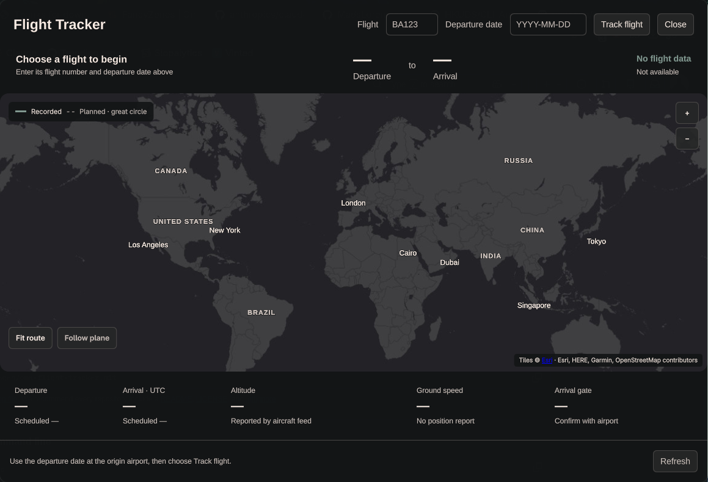

# Flight Tracker

A native Omarchy Quattro bar plugin. The Nerd Font `nf-md-airplane` glyph (U+F001D) in the topbar opens a theme-aware geographic map with aircraft position, observed flight path, country boundaries, major cities, departure/arrival times, aircraft details, altitude, ground speed and arrival gate.



## Install

Requires Omarchy Quattro, Python 3, and internet access. No API key or extra Python packages.

```sh
omarchy plugin add https://github.com/voyagen/oma-flight-tracker.git --enable
```

This clones the plugin into `~/.config/omarchy/plugins/voyagen.flight-tracker`, validates it, and asks where to place the bar icon (right by default). It does not replace the clock or start another Quickshell process.

```sh
omarchy plugin update voyagen.flight-tracker
omarchy-shell shell summon voyagen.flight-tracker '{}'
omarchy-shell shell hide voyagen.flight-tracker
omarchy plugin remove voyagen.flight-tracker
```

## Follow a flight

New installs start with **no flight selected**. The flight and date fields are empty; example text is only a placeholder. Enter a flight number and its **departure date at the origin airport**, then choose **Track flight**. Selection persists in the Omarchy bar configuration and is restored after the bar injects its settings, including across shell restarts. No flight-data requests run until a flight is selected. Once selected, refresh runs every minute, including while the panel is closed. Updating the plugin preserves your saved selection.

Drag the map to pan, scroll to zoom, use **Fit route** to see the journey, or **Follow plane** to center on reported positions. The solid theme-accent line is the recorded track; the native dashed line is an illustrative great-circle route, not a filed flight plan. Long gaps in receiver coverage are not drawn as observed segments. Airport times are local to each airport; arrival dates are included when the flight crosses midnight.

The panel, controls, labels, route and aircraft use Omarchy's reactive `qs.Commons.Color` palette. Changing the selected theme updates the open panel without restarting it. Esri tiles automatically switch between light and dark geography based on the theme's background; geographic tile colors themselves are provided by Esri.

## Data integrity and availability

Flight data comes from Flightradar24 public endpoints, which are unofficial and can rate-limit, change or block requests. Live position and detail requests are separate. No personal flight observations or demo data are bundled. Tracking depends on the provider making the selected flight's history/details accessible; live tracking is not guaranteed. The panel identifies cached metadata and its observation time when available; ETA and gate may change. Confirm gate and arrival information with the airline/airport.

The helper persists date-isolated observations in `${XDG_CACHE_HOME:-~/.cache}/oma-flight-tracker`. It never estimates aircraft position from time elapsed. Missing coverage retains the last observation with its age. Flights require accessible detailed/history data to establish their selected departure date safely; failures are shown rather than silently attaching a different day's flight.

Map tiles: Esri [World Dark Gray Canvas](https://services.arcgisonline.com/ArcGIS/rest/services/Canvas/World_Dark_Gray_Base/MapServer) or [World Light Gray Canvas](https://services.arcgisonline.com/ArcGIS/rest/services/Canvas/World_Light_Gray_Base/MapServer), with Esri, HERE, Garmin and OpenStreetMap contributor attribution displayed on the map. Map availability requires network access. Tracking data: [Flightradar24](https://www.flightradar24.com/). This plugin is unaffiliated with these providers and is not a navigation instrument.

## Development

Edit the files in the installed plugin directory (`~/.config/omarchy/plugins/voyagen.flight-tracker`, a git clone); installed QML hot-reloads in the existing shell. If an already-loaded component remains cached, use `omarchy restart shell`. Plugin manifest format and lifecycle follow the [Omarchy plugin guide](https://plugins.omarchy.org/develop.html).

```sh
omarchy plugin validate .
python3 flight_backend.py --flight BA123 --date "$(date +%F)"
bash tests/run.sh
```

Qt Canvas forwards dash offsets to QPen: use positive cumulative distance divided by line width to preserve dash phase across route segments.

The native selection check requires Omarchy Quattro and a running desktop session. It exercises an empty first launch, saved-flight restoration, repeated initialization, and returning to an idle empty selection, plus the backend's offline date/track checks.

## License

[MIT](LICENSE). Map tiles and flight data belong to their respective providers; the code license does not grant redistribution rights to provider data.
